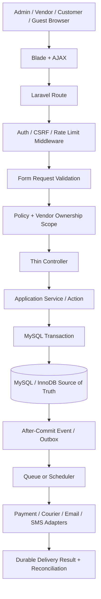

# ShopPilot Multi-Vendor Architecture and Architecture Decision Records

**Source authority:** `Multi_Vendor_Ecommerce_Requirements_PRD_BN.pdf` v1.0  
**Project baseline:** Laravel 13.34.0, PHP `^8.3`, MySQL/InnoDB, Blade, Bootstrap, jQuery/AJAX  
**Status:** Phase 3 design draft; owner decisions D-01 to D-12 remain open unless explicitly marked otherwise.

> This document is authoritative for the multi-vendor target architecture. Older single-vendor architecture notes remain historical references where they conflict with this document or the marketplace PRD.

## 1. Architecture goal

Convert the existing ShopPilot application into a multi-vendor marketplace without replacing its working Laravel application, authentication guards, CMS, customer account, category, product, media, wishlist, manual payment and admin modules.

The target remains a **service-oriented modular Laravel monolith**. It is not a microservice system.

## 2. Retained technical baseline

| Area | Decision |
|---|---|
| Application | Existing Laravel application; preserve current module boundaries |
| Backend | PHP / Laravel; use the versions declared by `composer.json` |
| UI | Blade, Bootstrap, JavaScript and jQuery/AJAX |
| Database | MySQL/InnoDB is the business source of truth |
| Staff authentication | `Admin` model, `admins` table, `admin` guard |
| Customer authentication | `User` model, `users` table, `web` guard |
| RBAC | Spatie Laravel Permission; keep guard separation |
| Media | Spatie Media Library; private vendor documents stay on private storage |
| Cart | Existing session-based cart remains the initial cart implementation |
| Cache | Optional only; never authoritative for stock, payment or finance |
| Background work | Database-backed queue / scheduler / outbox where hosting permits; Redis is not mandatory |
| Deployment | cPanel-compatible first release, subject to D-10 hosting verification |

## 3. Logical modules and ownership boundaries

| Module | Owns | Must not own |
|---|---|---|
| Identity & Access | Admins, users, roles, permissions, active vendor memberships | Vendor business decisions |
| Seller Onboarding | Vendor profile, store, documents, status history | Payment settlement calculations |
| Catalog | Categories, products, attributes, variants, moderation | Stock movement arithmetic |
| Inventory | Inventory balances, movements, reservations | Order payment state |
| Cart & Pricing | Session cart, server-side repricing, discount and allocation calculation | Client-submitted totals |
| Orders | Master order, vendor suborders, order-item snapshots, order histories | Provider webhook verification |
| Payments | Attempts, transactions, manual submissions, webhook inbox | Seller payout approval |
| Vendor Finance | Commission snapshots, seller ledger, settlement reconciliation, adjustments | Product publication |
| Payouts | Payout requests, payout execution evidence and reconciliation | Editing historical ledger entries |
| Fulfilment | Shipments, shipment items and tracking events | Payment verification |
| Returns & Refunds | Return/refund request and item-level outcomes | Silent stock restoration |
| Audit & Operations | Audit records, outbox, provider delivery attempts | Business ownership decisions |

Module names describe logical responsibilities. They do not require separate applications or premature service classes for every table.

## 4. Request and transaction architecture

### 4.1 Vendor authorization rule

Every vendor-owned route, query, AJAX action, file download and mutation must satisfy all of the following:

1. The authenticated `User` has an active row in `vendor_users` for the selected vendor.
2. The requested resource belongs to that same vendor, directly or through its parent relationship.
3. The membership role/permissions allow the requested action.
4. A global Spatie role alone is never proof of vendor ownership.
5. Vendor ID must be derived from the authorized membership/resource, never trusted from a hidden input or request payload.

### 4.2 Checkout transaction boundary

1. Read the session cart and re-fetch all products, variants, prices, eligibility and stock from MySQL.
2. Reject unavailable or mixed legacy/vendor cart combinations until D-01 ownership treatment is approved.
3. Begin a short transaction; lock the relevant inventory balance rows in deterministic order.
4. Re-check available quantity and create the master order, one vendor suborder per vendor, item snapshots and stock reservations.
5. Create a payment attempt/idempotency record when the chosen payment method requires it.
6. Commit before any slow external provider call.
7. Verify callbacks through a unique webhook inbox record; process each provider event once.
8. Consume or release reservations once, update payment/order states and write ledger entries in the same controlled transaction boundary.
9. Dispatch invoices, notifications, courier calls and analytics only after commit.

### 4.3 Source-of-truth rules

- MySQL owns products, ownership, stock, order, payment, ledger and payout state.
- Browser values are never authoritative for price, stock, discount, shipping, tax or commission.
- Provider references and verified evidence are required for external payment/payout claims.
- Session cart is a temporary selection container, not a financial record.
- Redis/cache may accelerate reads but cannot decide whether stock or money exists.

## 5. Architecture Decision Records

### ADR-001 - Keep a modular Laravel monolith

**Status:** Accepted.  
**Decision:** Retain one Laravel application and MySQL database, with logical modules and thin controllers.  
**Reason:** Preserves the current project, cPanel deployment target and existing codebase while keeping transactions local.  
**Consequence:** Module boundaries are enforced by code organization, service contracts and tests rather than network services.

### ADR-002 - Keep separate admin and customer guards

**Status:** Accepted.  
**Decision:** Staff remain `Admin` / `admins` / `admin`; customers and vendor users remain `User` / `users` / `web`.  
**Reason:** This is the existing authentication contract.  
**Consequence:** Vendor staff are customer-side users with explicit `vendor_users` membership; they are not Admin accounts.

### ADR-003 - Use pivot-based vendor membership

**Status:** Accepted.  
**Decision:** `vendor_users` is the membership boundary. It records vendor, user, membership role, status, scoped permissions and timestamps.  
**Constraint:** Unique `(vendor_id, user_id)`. Exactly one active owner is a business invariant enforced transactionally until a database-enforceable owner-slot design is approved.  
**Consequence:** A user may belong to more than one vendor only if the business later allows it; every request still selects and authorizes a specific membership.

### ADR-004 - Start with one vendor owner per product

**Status:** Proposed; D-01 confirmation required.  
**Decision proposal:** A product has one `vendor_id`; shared cross-vendor catalog ownership is deferred.  
**Compatibility:** Existing products with `vendor_id = NULL` remain legacy platform-managed records. They are not silently assigned to a vendor.  
**Open point:** Whether legacy platform-managed products can participate in the same cart as vendor-owned products, or must first be assigned to a platform vendor.

### ADR-005 - Preserve master orders and add vendor suborders

**Status:** Required by PRD; final field sign-off pending.  
**Decision:** Existing `orders` remains the customer-facing master order. Add `vendor_orders` with one child per vendor. New marketplace `order_items` belong to exactly one vendor suborder.  
**Compatibility:** Existing order rows and existing items remain legacy records; their new `vendor_order_id` is nullable during migration and remains null for legacy history.

### ADR-006 - Keep the session cart for the initial release

**Status:** Accepted as a compatibility decision; guest/persistence scope remains subject to D-12.  
**Decision:** Keep the current session cart; cart lines contain product and optional variant identifiers. Reprice all lines from MySQL at checkout.  
**Consequence:** No mandatory `carts` or `cart_items` tables are introduced in this design. A persistent cross-device cart is later scope.

### ADR-007 - Inventory must support simple and variable products

**Status:** Required design; migration detail to be approved before implementation.  
**Decision:** Use one inventory balance per stockable item. A simple product maps to a product-level balance; a variable product maps to a variant-level balance. Detailed reservations are stored separately.  
**Compatibility:** Current `inventory_balances` is variant-only and current simple products use `products.stock_quantity`. A staged additive migration is required before marketplace checkout can reserve both types uniformly.

### ADR-008 - Separate payment attempts, provider transactions and webhooks

**Status:** Required by PRD; provider selection D-03 pending.  
**Decision:** Payment attempt, verified provider transaction and webhook delivery are separate records. Each external event has a provider-scoped unique event ID and idempotent processing.  
**Compatibility:** Existing manual `payment_submissions` remains supported; do not label a manual submission or COD order as paid before verified collection.

### ADR-009 - Use an append-only vendor financial subledger

**Status:** Required by PRD; finance rules D-02, D-04, D-05 and D-07 pending.  
**Decision:** Record vendor earnings, commission, holds, releases, refunds, payouts and adjustments as immutable ledger entries. Corrections use reversal/adjustment rows.  
**Consequence:** A balance is derived from ledger entries by vendor, currency and bucket; a cached balance is never the only financial record.

### ADR-010 - Payout completion requires external transfer evidence

**Status:** Required by PRD; channel and evidence format D-03/D-05 pending.  
**Decision:** Approval is not payment. A payout reaches `paid` only after transfer reference/evidence is recorded and reconciled.  
**Consequence:** Failed or retried transfers do not silently consume or duplicate vendor funds.

### ADR-011 - Keep order, payment, shipment, refund and payout states separate

**Status:** Required by PRD.  
**Decision:** Each domain owns its own state machine. Master order state is an aggregate of vendor suborders for marketplace orders.  
**Consequence:** A COD order can be fulfilment-confirmed while its payment remains unpaid; a refund does not rewrite the original order or ledger history.

### ADR-012 - Preserve legacy data and introduce marketplace writes additively

**Status:** Accepted.  
**Decision:** Do not reset or delete existing users, products, orders, order items, payments, media or stock. Add nullable links and new tables, backfill only with an approved mapping, then cut over new marketplace flows.  
**Consequence:** Legacy order and product behavior remains readable during transition.

### ADR-013 - Do not implement policy-dependent finance or logistics before sign-off

**Status:** Blocked by PRD decision register.  
**Decision:** D-02 to D-08 and D-10 must be confirmed before final migrations/services for merchant-of-record, payment/COD, commission, tax, shipping, returns, payout and deployment are locked.  
**Consequence:** The Phase 3 schema is a reviewable design, not permission to guess these policies in code.

## 6. Open owner decisions

| ID | Decision required | Design impact |
|---|---|---|
| D-01 | Vendor-owned catalog vs shared catalog; treatment of existing null-vendor products | Product ownership and mixed-cart rules |
| D-02 | Legal merchant of record and payment collector | Payment, settlement, invoice and liability model |
| D-03 | Gateway/COD providers and split-payment support | Provider adapters, transaction refs and COD records |
| D-04 | Commission basis, discounts, taxes, shipping/payment fee inclusion and rule priority | Commission rules, snapshots and ledger postings |
| D-05 | Hold period, payout frequency/minimum and chargeback liability | Available balance and payout lifecycle |
| D-06 | Courier account owner, shipping fee allocation and COD collector | Shipping rules, COD collection and settlement |
| D-07 | VAT/tax responsibility, invoices, currency and rounding | Tax snapshots and financial precision |
| D-08 | Cancellation/return windows, restock trigger and dispute resolution | Refund/return state transitions and stock release |
| D-09 | Seller eligibility, document types and moderation SLA | Onboarding validation and retention |
| D-10 | cPanel PHP/worker/cron/resources and RPO/RTO | Queue/outbox processing and operations |
| D-11 | Consent, tracking ownership and Meta/GA4 account strategy | Analytics events and privacy retention |
| D-12 | Guest checkout, product publication and vendor staff scope | Customer access, moderation and membership permissions |

## 7. Phase 3 exit gate

The architecture and data design documents can be reviewed now. Phase 3 is **not financially signed off** until the owner and finance/operations reviewer approve the policy-dependent decisions, especially D-02 through D-08. No final production migration or finance controller implementation should be based on unresolved assumptions.
