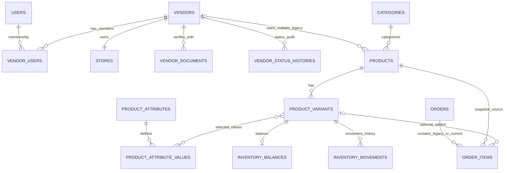
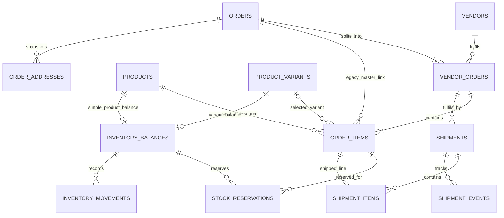
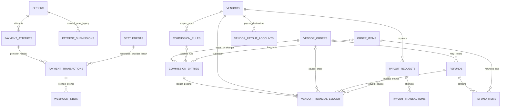
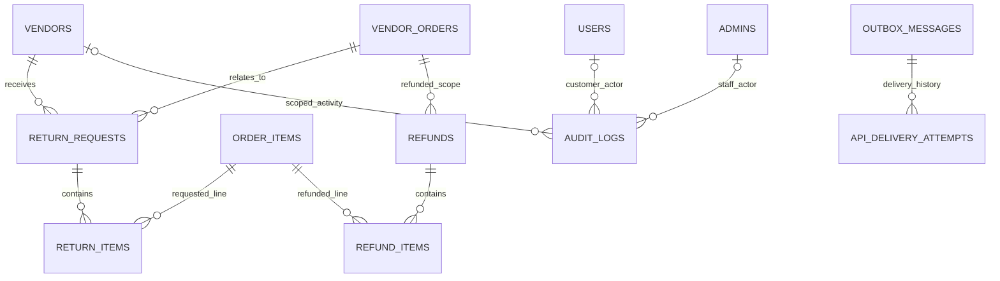
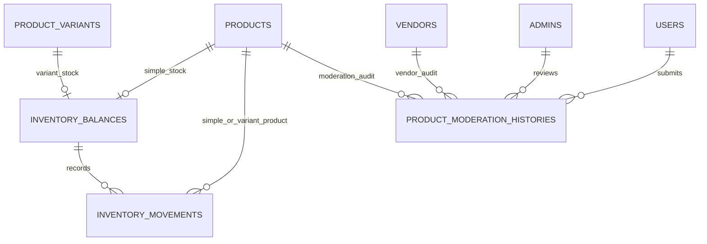

# ShopPilot Multi-Vendor Logical ERD

**Source:** Multi-Vendor E-commerce Requirements PRD v1.0  
**Status:** Phase 3 design draft; policy-dependent relationships are marked as proposed.  
**Physical field specifications:** `MULTI-VENDOR-TABLE-SPECIFICATIONS.md`.

## 1. Current implemented Phase 1 and Phase 2 relationships

This diagram describes the marketplace-related relationships already present in the uploaded project. It does not imply that master/suborders, reservations, payment gateway records or finance tables already exist.

Current facts:

- `products.vendor_id` is nullable to preserve existing platform-managed products.
- `product_variants` are children of products; their vendor is derived through `products.vendor_id`.
- `inventory_balances` is currently variant-only. Simple products still use `products.stock_quantity`.
- `orders` is currently a single order header; `vendor_orders` does not exist yet.
- `order_items` already has nullable variant reference and variant snapshot fields from Phase 2.

## 2. Target marketplace order and inventory relationships

### Order ownership invariant

- `orders` is the customer-facing master record.
- `vendor_orders` is the seller-facing fulfilment and financial unit.
- Every new vendor-owned marketplace line belongs to exactly one `vendor_order`.
- `vendor_orders.vendor_id` is immutable after checkout.
- `order_items.order_id` is retained for compatibility with existing code/history.
- New marketplace order items carry `vendor_order_id` and a vendor ownership snapshot.
- A composite foreign-key design must prevent an item from referencing a vendor suborder that belongs to a different master order or vendor.
- Existing historical order items keep `vendor_order_id = NULL` until a separately approved backfill mapping exists.

## 3. Target payment and financial relationships

Relationship notes:

- Payment is initiated against the master order. Vendor suborders do not each charge the customer independently in the initial single-checkout model.
- Manual `payment_submissions` remains a separate existing flow; gateway attempts and transactions are separate records.
- A commission entry stores the exact rule/basis snapshot used at purchase time.
- The vendor ledger is a per-vendor subledger. Payment-provider settlement into the marketplace and transfer from marketplace to seller are different financial events.
- A payout request may have multiple transfer attempts. Only verified transfer evidence can mark it paid.
- Refunds can be partial and must reference the relevant vendor order and order items.

## 4. Target returns and operations relationships

Returns, audit, outbox and provider delivery tables are target entities. Exact retention and courier integration are still subject to D-06, D-08, D-10 and D-11.

## 5. Ownership and key matrix

| Resource | Ownership source | Required scope |
|---|---|---|
| Store | `stores.vendor_id` | Active vendor membership + store/vendor match |
| Product | `products.vendor_id` | Active membership + product vendor match |
| Variant | `product_variants.product_id -> products.vendor_id` | Scope through parent product |
| Inventory balance | Product or variant stock target | Scope through product/variant owner |
| Vendor suborder | `vendor_orders.vendor_id` | Active membership + exact vendor match |
| Order item | `order_items.vendor_order_id` + vendor snapshot | Scope through vendor order; never by `order_id` alone |
| Shipment | `shipments.vendor_order_id` | Scope through vendor order |
| Return/refund | Vendor order and item links | Scope through vendor order; finance/admin authorization for approval |
| Vendor ledger | `vendor_financial_ledger.vendor_id` | Active membership; finance permissions for admin operations |
| Payout request/account | `vendor_id` | Vendor owner/authorized finance role only |
| Vendor document | `vendor_documents.vendor_id` | Vendor owner upload; authorized admin review; private download |

## 6. Legacy compatibility rules

1. Existing `orders` and `order_items` remain valid historical records.
2. Existing orders are not split retroactively unless a deterministic, reviewed ownership mapping exists.
3. Products with `vendor_id = NULL` remain legacy platform-managed products; no automatic vendor assignment is allowed.
4. New vendor-owned product creation must set vendor ownership from the authenticated membership, not from the request body.
5. Mixed cart behavior for legacy platform products and vendor products is blocked pending D-01.
6. Existing product-level stock remains compatible until simple-product inventory is migrated to the unified stock-balance design.
7. No historical order, order item, payment, refund or ledger row may be cascade-deleted as a side effect of product/vendor deletion.

## Phase 5A inventory and moderation additions

`inventory_balances` has exactly one stock owner at application level: `product_id` for simple products or `product_variant_id` for a variant. `inventory_movements` stores the balance reference and actor attribution while retaining the legacy admin actor field.
