# ShopPilot Multi-Vendor State Machines

**Source:** Multi-Vendor E-commerce Requirements PRD v1.0  
**Status:** Design draft. Existing states are identified separately from proposed marketplace states. Exact policy-dependent transitions require owner sign-off.

## 1. State ownership principle

Order, payment, shipment, refund, reservation, vendor and payout states are separate. One state must not be used as a shortcut for another.

Examples:

- COD may be fulfilment-confirmed while payment is still unpaid.
- A submitted manual payment proof is not a verified payment.
- A delivered shipment does not itself mean the seller has been paid.
- A payout approval does not mean a bank/mobile-financial transfer completed.
- A refund does not rewrite the original sale or delete its ledger history.

## 2. Vendor lifecycle

**Implemented states and transitions:**

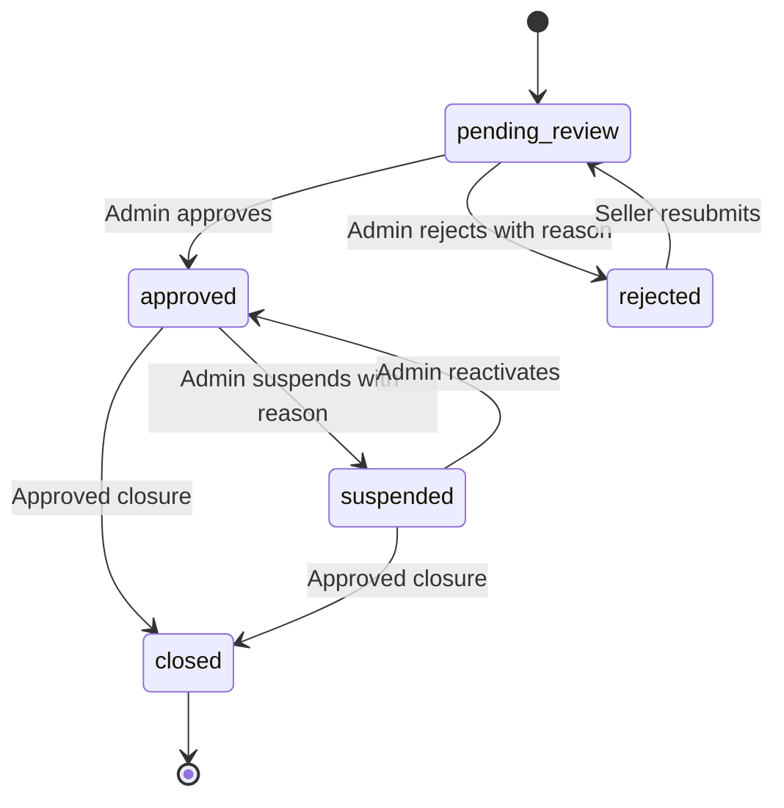

Current values in `App\Models\Vendor`:

- `pending_review`
- `approved`
- `rejected`
- `suspended`
- `closed`

Rules:

- Rejection must have a reason and resubmission policy.
- Suspension blocks prohibited new sales/actions but does not remove open orders, refunds or payout liabilities.
- Closure is terminal in the current model; it must not orphan financial or fulfilment records.
- Every transition creates a `vendor_status_histories` row.

## 3. Vendor document lifecycle

**Proposed:**

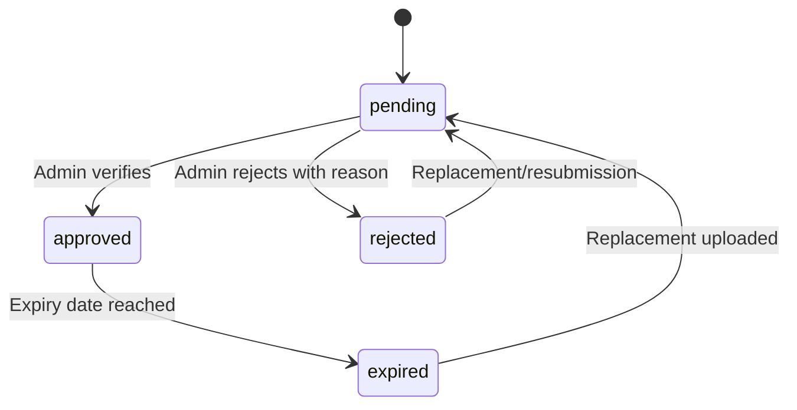

Document types, expiry policy, retention and required evidence remain subject to D-09 and applicable privacy/legal review.

## 4. Product publication and moderation

Two independent fields must remain separate:

- `products.status`: commercial availability (`active` / `inactive` in the existing project).
- `products.moderation_status`: marketplace review lifecycle.

**Proposed vendor product moderation states:**

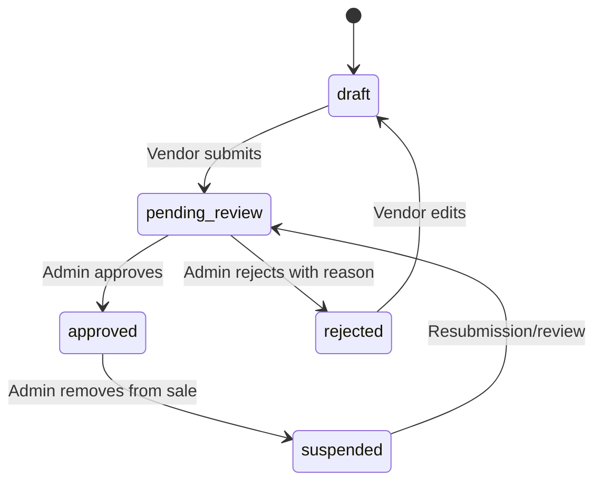

The default publication rule (auto-approve vs review-before-publish) is D-12 and must be confirmed. The current Phase 1 migration default of `approved` is not proof that this policy has been approved.

## 5. Stock reservation lifecycle

**Target states:**

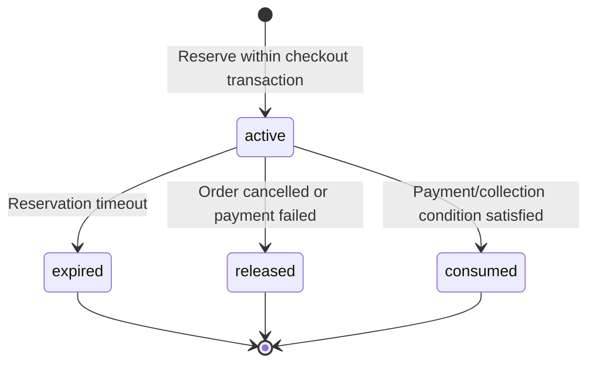

Invariants:

- `available_quantity = on_hand_quantity - reserved_quantity`.
- `reserved_quantity` is updated in the same transaction as reservation rows.
- No reservation may make available quantity negative.
- Consume, release and expire are idempotent; one reservation cannot be consumed twice.
- Late payment success after expiry follows a reconciliation path. It must not fulfil against stock that has already been released.
- Lock inventory balances in deterministic order to reduce deadlocks.

## 6. Master order and vendor suborder lifecycle

The existing `orders.order_status` states remain for legacy orders:

```text
pending -> confirmed -> processing -> shipped -> delivered
pending / confirmed / processing -> cancelled (existing transition constraints apply)
```

For new marketplace orders, vendor suborders own fulfilment state. The master order is a customer-facing aggregate and must not be independently advanced by a seller.

**Proposed vendor suborder states:**

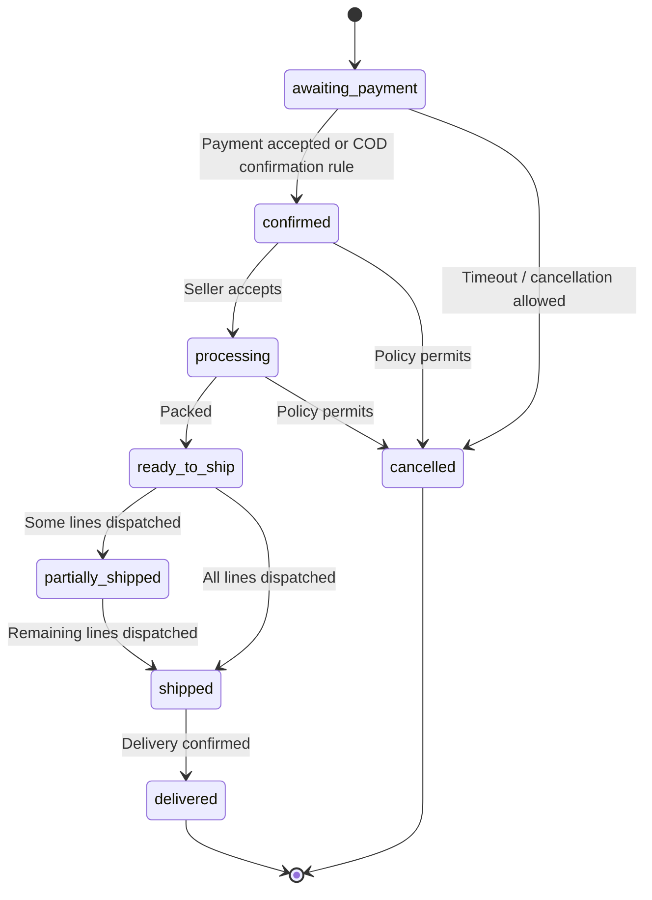

`partially_shipped` and `awaiting_payment` are proposed marketplace values, not current `Order` model constants. Final transition conditions and cancellation cut-offs depend on D-08 and D-06.

### Master order aggregation

- Master order status is derived from all child vendor suborders.
- If all suborders are delivered, master order is delivered.
- If all suborders are cancelled, master order is cancelled.
- If child suborders have mixed progress, master order uses an explicit aggregate status such as `partially_fulfilled`; final labels require UI/owner approval.
- Payment status is aggregated separately from fulfilment status.
- Legacy orders without vendor suborders continue using the current legacy state machine.

## 7. Payment lifecycle

### 7.1 Existing manual payment submission

Current manual payment states:

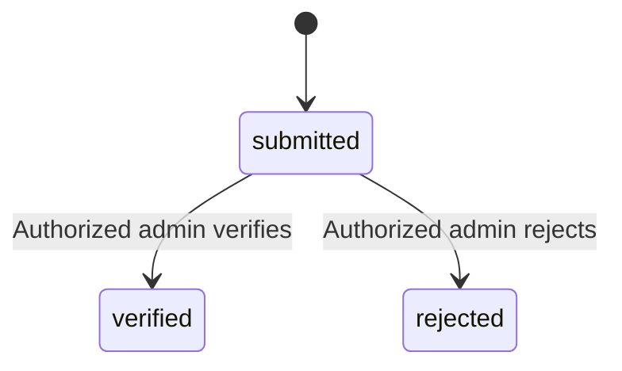

`submitted != verified`. The existing `orders.payment_status` values (`unpaid`, `submitted`, `verified`, `rejected`) must not be confused with order fulfilment status.

### 7.2 Future provider payment attempt

**Proposed:**

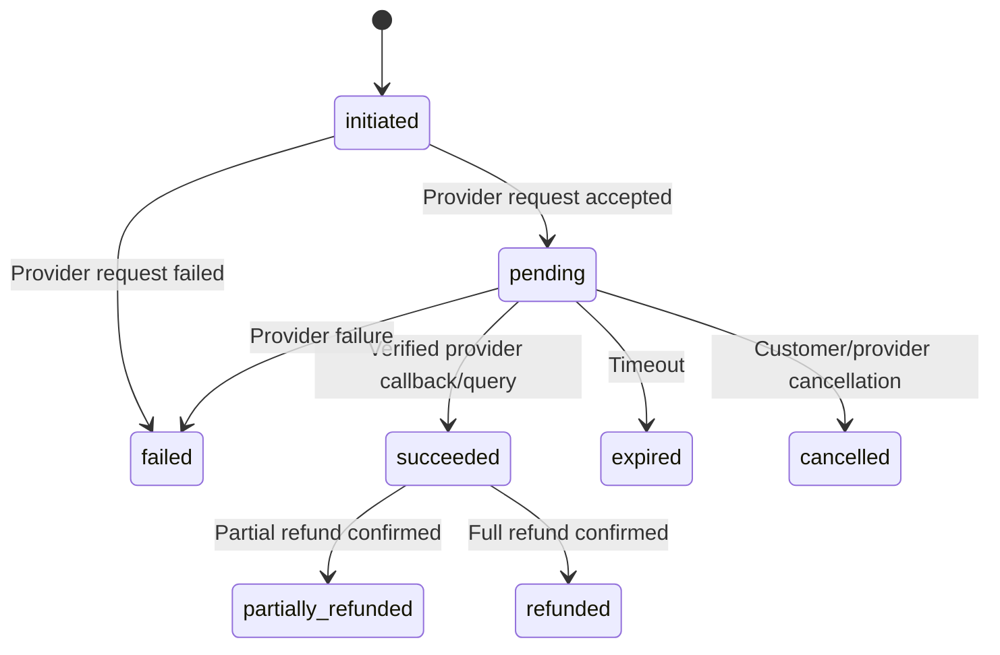

- Provider callbacks must be signature/time validated.
- A provider event is processed once using a unique `(provider, event_id)` inbox key.
- `succeeded` requires amount, currency, order and provider reference checks.
- A late success after reservation expiry is an exception requiring reconciliation.
- D-03 determines provider-specific states and fields.

### 7.3 COD

COD is not paid at order confirmation or dispatch. It remains unpaid until cash collection and required remittance evidence are recorded. Collector identity, RTO handling and seller eligibility are D-06; do not invent a final COD state machine before approval.

## 8. Shipment lifecycle

**Proposed:**

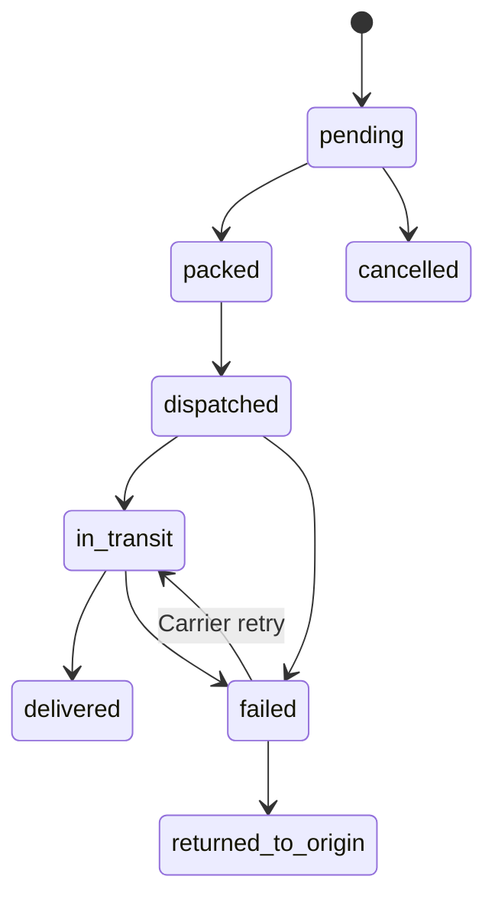

A vendor suborder may have multiple shipments. `shipment_items` carries the shipped quantity per order item, allowing partial fulfilment. Carrier-specific states are mapped into the marketplace states. D-06 determines the courier contract and event source.

## 9. Return and refund lifecycle

**Proposed refund states:**

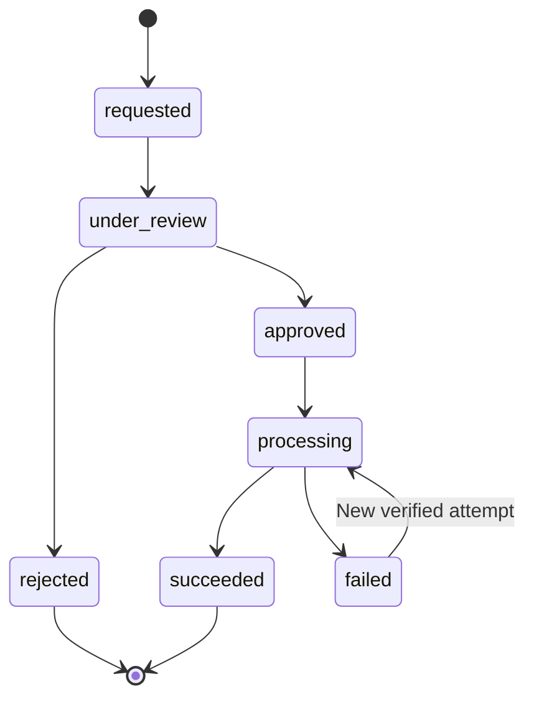

Rules:

- Refund can be full or partial and must reference order items and quantities.
- Refund amount is bounded by the eligible captured/collected amount.
- A provider/COD repayment confirmation is stored separately from internal approval.
- Commission and seller earning are reversed through new ledger entries.
- Stock is restocked only after the D-08 policy-defined condition (for example, return received and inspected); refund approval alone is not a stock-restock trigger.
- If the seller was already paid, create a documented receivable/adjustment rather than rewriting old ledger rows.

## 10. Payout lifecycle

**Proposed:**

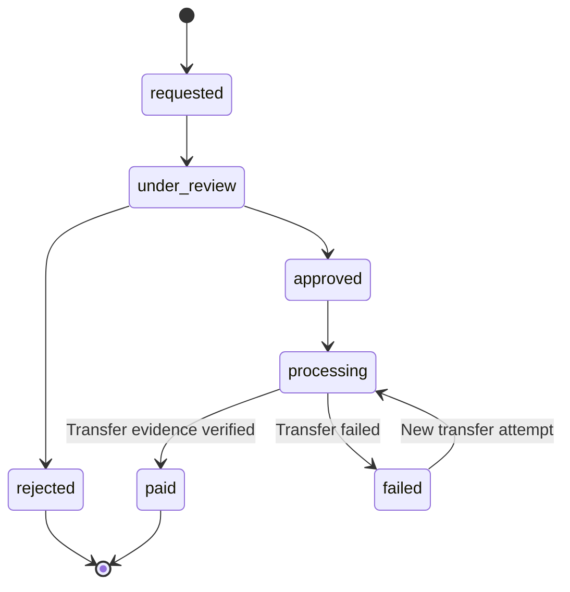

- A request can have multiple payout transaction attempts.
- A failed transfer releases the held amount back to the eligible bucket only after reconciliation.
- `paid` requires external transfer reference/evidence and confirmation; internal approval alone is insufficient.
- Payout thresholds, hold period, frequency and chargeback liability depend on D-05.

## 11. Ledger lifecycle

Ledger entries are append-only facts, not mutable state records.

- A correction creates a reversal or adjustment entry linked to the original reference.
- A payout request may move value between available and held buckets; a confirmed transfer moves held to paid-out.
- A failed transfer reverses the hold movement.
- No update/delete of posted financial entries is allowed through normal application operations.

## 12. Required cross-state tests

- COD vendor suborder can progress through fulfilment while master payment remains unpaid.
- Payment webhook replay cannot confirm or consume a reservation twice.
- Expired reservation + late payment success cannot oversell.
- Partial shipment does not mark the entire vendor suborder delivered.
- Partial refund changes only eligible line quantities and corresponding ledger amounts.
- Payout cannot exceed eligible balance; failed transfer cannot be shown as paid.
- Vendor suspension blocks new prohibited actions but preserves existing suborders, refunds, ledger and payouts.

## Phase 5A product moderation implementation

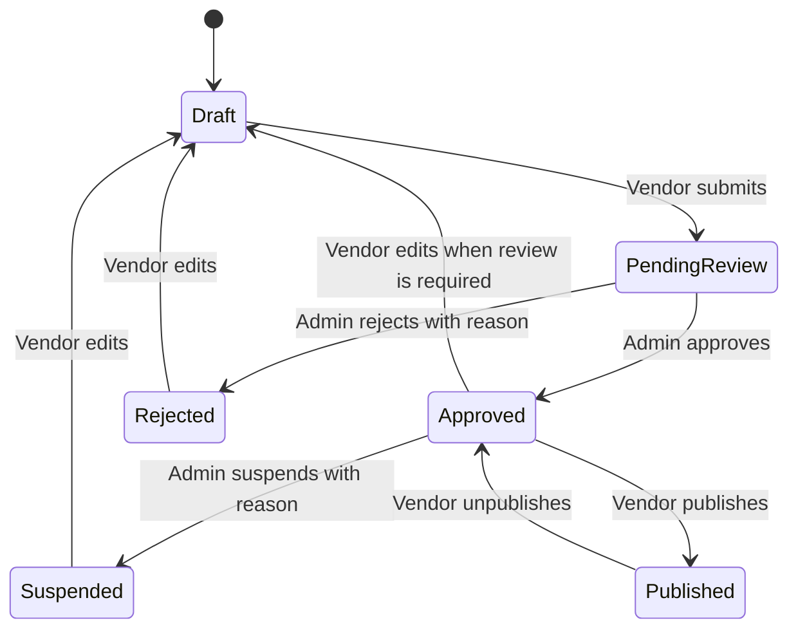

The moderation state (`moderation_status`) and availability state (`status`) are separate. Admin approval does not auto-publish; the vendor explicitly publishes an approved listing. `SHOP_VENDOR_PRODUCTS_REQUIRE_MODERATION` defaults to `true` until PRD decision D-12 is approved. Existing vendor products are not bulk-reset by the Phase 5A migration.
